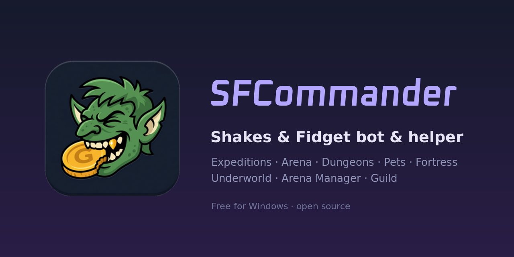

# SF Commander – Shakes & Fidget Bot & Helper (S&F, SFGame)




**SF Commander** is a free, open-source **Shakes & Fidget bot** and desktop helper for Windows. It plays your S&F characters for you: tavern expeditions, arena, city guard, dungeons, pets, fortress, underworld, Arena Manager and guild. It goes at a human pace, so every character gets the most out of every day without spamming the game server.

`Rust` · `Windows` · `English & Czech UI` · `multiple characters` · `S&F account, Steam & Google login`


---

## Why SF Commander

- **Plays like an experienced player.** Expeditions are picked for maximum heroism, beer is drunk in batches, the city guard only starts when the tavern is done for the day, and mushrooms are only ever spent above the reserve you set.
- **Plays like a human, not a script.** One request at a time, random pauses, play sessions a few times a day and quiet night hours. A single safety slider goes from 0 (off) to 10.
- **Simulates before it fights.** Dungeon, arena, pet and guild battle odds are worked out before a fight is sent, and the fight log compares the simulation with what really happened.
- **Helps run the whole guild.** Member grades, kick / watch / promote advice, attendance, raid and guild battle sign-ups, recruitment.

## Features

### Tavern, quests & city guard
- Automatic **expeditions**: crossroads, encounters and rewards picked the way an experienced player would
- **Beer** in batches (VIP free beer optional), thirst used up every day
- **City guard** work once the tavern is finished
- **Mount**: buys and renews the best affordable one (dragon, tiger, horse, cow) and never downgrades a running mount
- **Hourglasses**, **wheel of fortune**, **dice game**, **calendar**, **daily tasks** and **event task** rewards, mail rewards

### Arena & scrapbook (album)
- Free **arena** fights against the weakest beatable opponent, with free re-rolls of a bad opponent offer
- **Hall of Fame crawler** that finds players with items still missing from your **scrapbook**
- **Fight log**: simulated odds vs. real results

### Dungeons
- **Light and shadow dungeons**, **Tower**, **Demon Portal**: win chance simulated before every fight
- Mushroom fights only within your daily budget
- Keeps room in the **backpack** so loot is never lost

### Pets
- **Pet feeding**, **pet dungeons** and **pet arena** fights with a pet battle simulation

### Arena Manager (idle game)
- Building upgrades that always spend the money, and automatic **sacrifice** for **runes** at your threshold

### Fortress
- Collects **wood** and **stone**, builds and upgrades, trains units, **Hall of Knights**, **gem mine**, **fortress attacks**

### Underworld
- Collects **souls** and gold, upgrades **Heart of Darkness**, **Soul Extractor**, **Gladiator Trainer** and **Gold Pit**, keeper and units, **lures heroes**

### Character & equipment
- **Attributes**, gear from the **weapon shop** and **magic shop** by item score (epic and legendary items, runes)
- **Gems**: sockets empty slots, replaces only for a real gain, sells weak ones
- **Blacksmith** upgrades, **witch** enchantments
- Gear for the companions **Bert, Mark and Kunigunde**

### Guild
- Member overview: activity, attack / defense, portal, **treasury / instructor / knights**, contribution and advice
- Guild history journal and attendance
- **Raid** and **guild battle** sign-ups (attack & defense), **guild portal** and **hydra**, guild skills
- **Guild finder** for characters without a guild, recruitment invites
- **Guild chat** archive and readable chat codes, mail

### App
- Several accounts and characters in one window
- English and Czech interface
- Automatic updates
- Offline preview mode with sample data
- Crash-safe saving of settings (`helper.toml` with backup)

## Download & install

Get the latest release from **[Releases](../../releases)**:

- **`SF-Commander-Setup-x.y.z.exe`** is the installer. It needs no admin rights and installs into `%LOCALAPPDATA%\Programs\SF Commander`. It adds a Start menu entry and an optional desktop shortcut, and you can uninstall it from Windows *Apps*.
- **`SF-Commander-x.y.z.exe`** is the same app as a single portable file. Put it in any folder and run it.

Updates install themselves. Settings are kept next to the app in `helper.toml`. **Never share that file**, because it holds your login.

The app is not code-signed, so Windows SmartScreen may show *"Windows protected your PC"*. Click **More info → Run anyway**.

## Build from source

1. Install **Rust** (stable) from [rustup.rs](https://rustup.rs).
2. On Windows, also install **[Visual Studio Build Tools](https://visualstudio.microsoft.com/visual-cpp-build-tools/)** with the *Desktop development with C++* workload.
3. Run:

```
git clone https://github.com/sfcommander-app/sf-commander.git
cd sf-commander
cargo build --release --locked
```

The app is `target/release/sf-commander.exe`. It is a single file, so copy it anywhere and run it. The first build downloads and compiles all dependencies, which can take a while. Run the tests with `cargo test --locked`.

## Česky

**SF Commander** je bot a pomocník pro **Shakes & Fidget** (S&F, SFGame) na Windows. Hraje za tebe:
- **Hospoda:** výpravy, pivo, houby, přesýpací hodiny, kolo štěstí, kostky.
- **Městská stráž a mount.**
- **Aréna a album:** crawler síně slávy.
- **Dungeony:** světelné, stínové, věž a démonský portál.
- **Peti:** krmení, pet dungeony a pet aréna.
- **Arena Manager:** budovy a obětování za runy.
- **Pevnost:** dřevo, kámen, důl na drahokamy, síň rytířů a útoky.
- **Podsvětí:** duše, srdce temnoty a vylákání hrdinů.
- **Výbava:** obchody, drahokamy, kovář, čarodějnice a společníci.
- **Cech:** přehled členů, rady kopnout / sledovat / povýšit, docházka, nájezdy, cechovní bitvy, portál, hydra, hledání cechu a nábor.

Hraje lidským tempem, s pauzami a nočním klidem. Rozhraní je česky i anglicky.

## Disclaimer

SF Commander is an unofficial fan project and is not affiliated with or endorsed by Playa Games. Shakes & Fidget is a trademark of Playa Games GmbH. Automating the game may be against its terms of service, so use it at your own risk.

## License

MIT – see [LICENSE](LICENSE).

<sub>Keywords: shakes and fidget bot, shakes & fidget bot, s&f bot, sfgame bot, sf game bot, shakes fidget helper, shakes and fidget automation, auto play, scrapbook helper, album helper, arena manager bot, idle bot, dungeon bot, fortress bot, underworld bot, guild manager, hall of fame crawler, mushrooms, shakes and fidget tool, shakes and fidget bot deutsch, s&f bot cz, shakes and fidget bot zdarma</sub>
